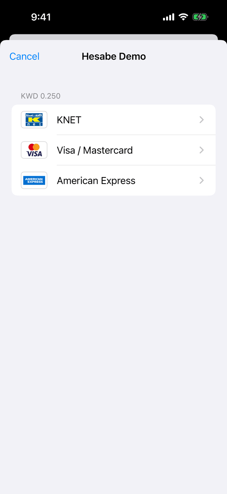
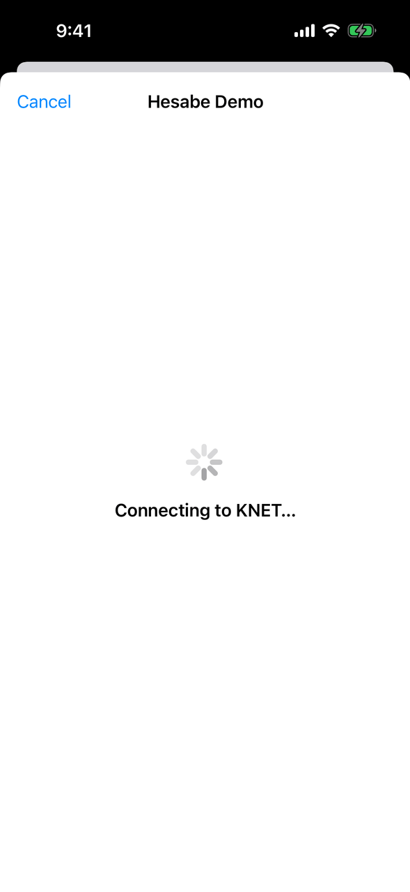
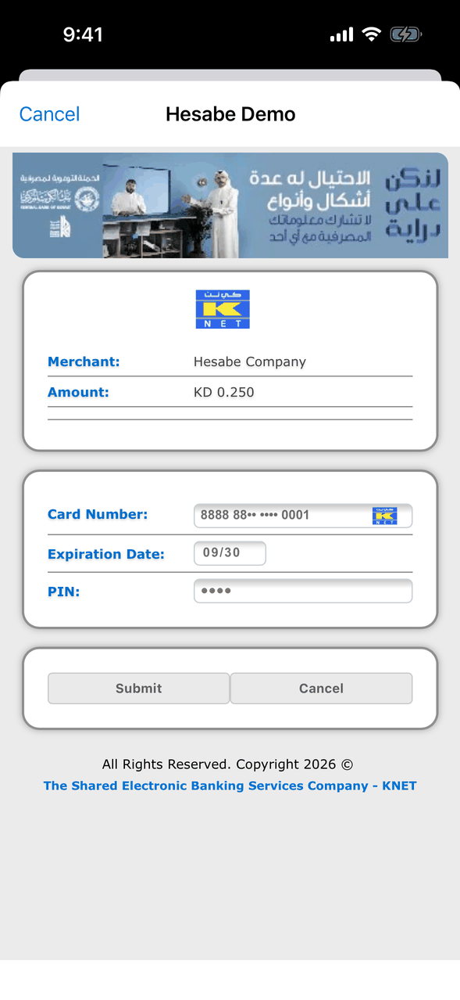
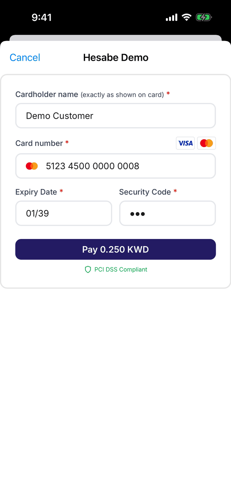

# Hesabe iOS SDK: how it works

The SDK takes one payment session from your server and does the rest on the device: it
shows the payment, follows the customer through KNET, 3-D Secure or Apple Pay, asks
Hesabe how the payment ended, and returns that to your app.

This page explains what happens at each step and why it is built that way. The
[integration guide](INTEGRATION.md) has the steps and the code.

## A session, not a key

Hesabe's APIs are called with a merchant's access code, secret key and IV key. Anything
compiled into an app can be read out of it, so keys in an app are keys anyone can use: to
create sessions for any amount, to read the merchant's transactions and to charge its
customers' saved cards.

So the SDK is built on a session. Your server creates it with the Checkout API and sends
the app one string, `response.data`. That string opens one payment and cannot create
another.

| | Your server | The app and the SDK | Hesabe |
|---|---|---|---|
| Merchant keys | Holds them. | Never sees them. | Issued them. |
| The price | Computes it. | Sends what was ordered, never what it costs. | Charges what the session says. |
| The session's `data` | Receives it from Hesabe. | Holds it for one payment. | Created it. |
| The session's `token` | Stores it with the order. | Reads it from the session, to ask for the outcome. | Records the payment under it. |
| The card number | Never sees it. | Never sees it: it is typed into Hesabe's page. | Receives it. |
| The result | Confirms it with its keys before releasing the order. | Shows it to the customer. | Is the source of it. |

The SDK contains no encryption. Everything it sends to Hesabe is the session's `data`
or the session's token.

## A payment, step by step

```text
Customer        App and SDK                Your server              Hesabe
   |  taps Pay      |                           |                      |
   |--------------->|  POST /payments/session   |                      |
   |                |-------------------------->|  POST /checkout      |
   |                |                           |--------------------->|
   |                |                           |  token, data         |
   |                |  data                     |<---------------------|
   |                |<--------------------------|                      |
   |                |  GET api/checkout-details?data=                  |
   |                |------------------------------------------------->|
   |                |  token, amount, enabled methods                  |
   |                |<-------------------------------------------------|
   |  method list   |                           |                      |
   |<---------------|                           |                      |
   |  chooses KNET  |  GET payment?data=&paymentType=1                 |
   |--------------->|------------------------------------------------->|
   |  KNET's page, in the sheet                                        |
   |<------------------------------------------------------------------|
   |  pays          |                           |                      |
   |------------------------------------------------------------------>|
   |                |  navigation to responseUrl, stopped by the SDK   |
   |                |<-------------------------------------------------|
   |                |  GET api/transaction/enquire/<token>             |
   |                |------------------------------------------------->|
   |                |  SUCCESSFUL                                      |
   |                |<-------------------------------------------------|
   |  "Payment      |  POST /payments/confirm   |                      |
   |   complete"    |-------------------------->|  GET api/transaction/<token>
   |<---------------|                           |--------------------->|
   |                |  paid                     |  SUCCESSFUL          |
   |  receipt       |<--------------------------|<---------------------|
   |<---------------|                           |                      |
```

1. The app asks your server for a session. It sends what was ordered.
2. Your server computes the amount, calls `POST /checkout` with `paymentType` `0`, stores
   the `token` with the order and returns `response.data` to the app.
3. The app presents the checkout sheet with the session. The sheet is on screen at once,
   with a loader.
4. The SDK reads the session with `GET api/checkout-details?data=<data>`. Hesabe answers
   with the session's token, amount, currency and the payment types enabled for it.
5. The SDK writes the token down on the device, then opens the payment in a web view
   inside the sheet.
6. The customer pays on Hesabe's, KNET's or the bank's page.
7. Hesabe navigates to the session's `responseUrl` or `failureUrl`. The SDK stops that
   navigation before it loads and covers the page with "Confirming your payment…".
8. The SDK asks Hesabe how the payment ended, with
   `GET api/transaction/enquire/<token>`, and returns the result to the app.
9. The app shows the result. Your server confirms it with its own keys before it
   releases the order.

Steps 4 and 8 need no key. The session's `data` and token are enough for them and for
nothing else.

## What the checkout sheet shows

| The method list | Opening the method | KNET's page | Hesabe's card form |
|---|---|---|---|
|  |  |  |  |

- The sheet is presented the moment `present` is called. The request for the session's
  details runs while the sheet rises, so the loader costs the customer no time.
- A lost connection while the session is read is reported in the sheet with a "Try
  again" button. Reading a session changes nothing at Hesabe, so it is safe to repeat.
- The method list is native. It shows the methods you asked for that the account has,
  each with Hesabe's logo and the amount above them.
- The payment page is Hesabe's, in a web view under your app's title bar. A loader with
  a line of text ("Connecting to KNET…", "Opening secure card form…") covers it until
  the first page has finished loading.
- When the flow ends the page is covered again while Hesabe is asked, and the settled
  outcome stays on screen for a moment before the sheet closes: "Payment complete",
  "Card saved" or "Payment not completed".
- The customer cannot swipe the sheet away. Cancel is the way out, so the end of every
  payment is seen and looked up.

## How each method opens

`methods` in `present` decides what the SDK opens. One session, created with
`paymentType` `0`, serves all of them.

| The app passes | The SDK opens | What Hesabe serves |
|---|---|---|
| `[.knet]` | `GET payment?data=<data>&paymentType=1` | A redirect straight to KNET's page. |
| `[.card]` | `GET pay/webview?data=<data>&locale=en` | The embedded card form: the card fields and a pay button, with 3-D Secure in the same page. |
| Several methods | The native list, then the chosen method as above. | |
| No methods | `GET payment?data=<data>` | Hesabe's Indirect Method page, with every method enabled on the account. |
| The Apple Pay button | Your hosted button page, with the payment's settings in the URL fragment. | Hesabe's Apple Pay script validates the merchant and takes the payment. |

### Cards and card gateways

Hesabe has one payment type per card gateway: 2 is Visa and Mastercard through MPGS, 5
is the same cards through CyberSource, and 7 and 8 are American Express. Which gateway
an account has is Hesabe's setting, and it can change: the sandbox account listed MPGS on
17 November 2026 and CyberSource from 26 November 2026.

The SDK reads the gateway from the session and does not ask the app to know it:

- `.card` is offered as whichever of 2 and 5 the account has. `.amex` stands for 7 and 8
  the same way.
- A card opens in the embedded card form when the account has the Direct Method. The
  form uses the account's gateway whichever card type was asked for.
- A card on an account without the Direct Method, and American Express until the form
  lists it for the account, opens Hesabe's payment page for that card type instead.

Hesabe serves the card form to in-app web views only. A browser, and an iPad web view
that asks for desktop pages, get HTTP 403 (sandbox, November 2026). The SDK asks for the
mobile page on every device.

## How the result is decided

The flow in the web view ends in one of three ways: Hesabe navigates to a return URL, the
customer taps Cancel, or the page fails to load. None of them says how the payment ended.
Reaching `responseUrl` proves nothing, and the Apple Pay sheet says "Done" before Hesabe
answers. So in every case the SDK asks Hesabe, with
`GET api/transaction/enquire/<token>`:

| What Hesabe has for the token | After a return | After Cancel |
|---|---|---|
| An attempt with status `SUCCESSFUL` | `.paid` | `.paid` |
| An attempt with status `AUTHORIZED` and amount `0.000` | `.cardSaved` | `.cardSaved` |
| An attempt with status `FAILED`, `CANCELLED` or `DECLINED` | `.failed` | `.failed` |
| An attempt with any other status | `.pending` | `.pending` |
| No transaction: HTTP 404 "Transaction not found" | `.unconfirmed(.noTransaction)` | `.canceled` |
| No answer from Hesabe | `.unconfirmed` | `.unconfirmed` |

- After a return a transaction is expected, so the lookup is repeated for about ten
  seconds while Hesabe records it: five lookups at most, because Hesabe limits lookups.
- After Cancel there is one lookup. A customer who paid and then tapped Cancel still gets
  `.paid`.
- When the page failed to load and Hesabe has no transaction, the result is
  `.notStarted`: nothing was paid.
- A session Hesabe has recorded several attempts for is paid if any of them is.

The statuses were read on the sandbox in November 2026: `SUCCESSFUL` for a paid KNET and
card payment, `FAILED` for a declined card and for an abandoned 3-D Secure, and
`AUTHORIZED` with amount `0.000` for a card saved without a charge.

### Why your server confirms it

The result the SDK returns is Hesabe's answer, read on the customer's device. A device
can be tampered with, so that answer is for the screen. Your server stored the session's
token when it created the session. It asks Hesabe's Transaction Enquiry API by that
token, with its keys, and releases the order when the record is paid and its amount and
order reference are the order's. A webhook from Hesabe is a prompt for the same lookup.

The demo shows both answers on its result screen, "What the SDK reported" beside "What
the server confirmed with Hesabe".

## Payments the app never saw finish

A customer can pay in a banking app and never come back, and iOS can close the app during
3-D Secure. Hesabe has no idempotency keys, so a payment must never be sent twice to find
out.

The SDK writes the session's token to `UserDefaults` before the payment page opens. It
removes the token when Hesabe reports the payment paid, failed or never attempted. A
token that is still there at the next launch is a payment whose end the app did not see:
`HesabeClient.recoverPayments()` asks Hesabe about each and returns those that have since
been paid, saved or failed. Tokens older than a week are dropped.

The token is the only thing the SDK itself writes to the device. The web views use a
non-persistent data store, so cookies and card entry do not outlive the payment. The
logos are public images, fetched with the system's URL loading and kept in memory while
the app runs.

## Saved cards

A saved card belongs to a Hesabe customer, and every call that creates the customer,
lists the cards, charges one or removes one needs the merchant keys. So those calls are
your server's, and the SDK has none of them.

| What happens | Who does it | Hesabe call |
|---|---|---|
| Create the customer, once per user | Your server | `POST api/direct-payment/customer` |
| Offer to save the card during a payment | Your server, in the session | `POST checkout` with `saveCard` and `customer_id` |
| Save a card without a charge | Your server, in the session | `POST checkout` with amount `0.000`, `saveCard` and `customer_id` |
| Enter the card | The SDK | Hesabe's card form |
| List the customer's cards | Your server | `GET api/direct-payment/cards` |
| Pay with a saved card | Your server | `POST api/direct-payment/charge-card` |
| Remove a card | Your server | `DELETE api/direct-payment/cards/{cardId}` |

The SDK's part is the card form. The session tells it what to show:

- A session with `saveCard` and a customer makes the form show "I agree that my card
  details will be securely saved".
- A session with amount `0.000` and a customer makes the form's button read "Save Card".
  Hesabe authenticates the card, stores it and charges nothing. It records that as
  `AUTHORIZED` with amount `0.000`, which the SDK returns as `.cardSaved`.

A charge on a saved card is one request from your server with no page and no 3-D Secure:
Hesabe authenticated the card when it was saved. The answer is the result, `CAPTURED`
when paid. Your server sends it once and never retries it, because a retry is a second
charge.

## Apple Pay

Apple Pay through Hesabe starts from a web page on a domain that Hesabe has registered
with Apple for the merchant. WebKit starts Apple Pay only on a page fetched over HTTPS
from that domain, so the page cannot ship inside the app.

So `HesabeApplePayButton` is a web view the size of a button. It loads
[`hosting/apple-pay.html`](../hosting/apple-pay.html) from your domain, and that page
draws WebKit's own Apple Pay button on a clear background. Around it the SDK draws the
native parts: a stand-in button while the page loads, a dimmed press, "Processing" while
Hesabe charges, and "Try again" with the reason when the page cannot start.

1. The SDK reads the session, as the checkout sheet does, and checks that the Apple Pay
   payment type is enabled for it.
2. It loads the hosted page with the payment's settings in the URL fragment: the
   session's `data`, the environment, the payment type and the button's wording and
   colours. Browsers never send the fragment to a server, so the page is the same static
   file for every payment and holds no keys.
3. The page loads Hesabe's Apple Pay script, pinned to a version and checked with an
   integrity hash, and shows the button.
4. The customer taps the button. Hesabe's script opens the Apple Pay sheet and validates
   the merchant with Apple through Hesabe.
5. The customer authorises. The script sends the page to Hesabe with the payment, and
   Hesabe navigates to the session's `responseUrl`.
6. The SDK stops that navigation and asks Hesabe how the payment ended, exactly as the
   checkout sheet does.

- Closing the Apple Pay sheet sends the page to a cancel address that the SDK also
  stops. The button stays ready for another tap.
- If Hesabe has not come back 45 seconds after the customer authorised, the SDK asks
  Hesabe anyway and reports what it finds.
- The SDK reads everything off navigations and injects no script into the page. WebKit
  turns Apple Pay off in a web view the app has injected script into.

The page as it is in this repository was not yet used for a payment. An earlier version
of it took a production payment in September 2026, from a merchant's own domain. With the
session described here, Hesabe answered the page's merchant validation with a valid Apple
session on production on 27 November 2026.

## What the web view has to do

`PaymentWebViewController` is the web view behind the sheet. An app that draws its own
screen with the `Hesabe` product has to do the same things:

- **Stop the return.** Hesabe returns to `responseUrl` with a server redirect, which
  WebKit reports to `didReceiveServerRedirectForProvisionalNavigation` and not to the
  navigation policy callback. The SDK checks the URL in the policy callback, the redirect
  callback and the response callback, and cancels the navigation in each, so a slow or
  missing page on the merchant's site cannot strand a customer who has paid.
- **Hand off to banking apps.** KNET and several issuers send the customer to a banking
  app over a custom URL scheme. A web view drops those silently. The SDK opens them with
  the system.
- **Open popups in place.** Some 3-D Secure pages open with `target="_blank"`, which a
  web view ignores. The SDK loads the page in the same view.
- **Ask for the mobile page.** An iPad web view asks for desktop pages by default, and
  Hesabe's card form answers those with HTTP 403.
- **Keep nothing.** The data store is non-persistent.
- **Inject no script.** No user scripts and no `evaluateJavaScript`, so Apple Pay keeps
  working in the same process.
- **Treat an early HTTP error as a refusal.** An error status on the first page is
  Hesabe refusing the session, and the result is `.notStarted`.

## The Hesabe calls

As run on the sandbox in November 2026:

| Call | Who makes it | Answer |
|---|---|---|
| `POST checkout` | Your server | The session's `token` and `response.data`. |
| `GET api/checkout-details?data=<data>` | The SDK | The session's token, amount, currency and enabled payment types. HTTP 400 for a session that is malformed, already used or from the other environment. |
| `GET payment?data=<data>` | The SDK | Hesabe's page with every method. |
| `GET payment?data=<data>&paymentType=1` | The SDK | A redirect straight to KNET. |
| `GET pay/webview?data=<data>&locale=en` | The SDK | The embedded card form. HTTP 403 to anything but an in-app web view. |
| `GET api/transaction/enquire/<token>` | The SDK | The transaction once one exists; 404 "Transaction not found" before. |
| `GET api/transaction/<token>` | Your server | Hesabe's record of the payment, for the confirmation. |
| `POST api/direct-payment/customer` | Your server | The `customer_id` saved cards belong to. |
| `GET api/direct-payment/cards` | Your server | The customer's saved cards. |
| `POST api/direct-payment/charge-card` | Your server | The charge, `CAPTURED` when paid. |
| `DELETE api/direct-payment/cards/{cardId}` | Your server | The card is removed. |

The hosts an app using the SDK reaches:

| Host | For |
|---|---|
| `sandbox.hesabe.com` or `api.hesabe.com` | The session, the payment pages, the card form and the outcome. |
| KNET's, the bank's and the card gateway's own hosts | The pages the customer pays and authenticates on, inside the web view. |
| `hesabe-assets-ir.s3.eu-west-1.amazonaws.com` | The method logos. |
| Your Apple Pay page's host, and `unpkg.com` for Hesabe's Apple Pay script | The Apple Pay button only. |

## The files

| File | What it does |
|---|---|
| `Hesabe/HesabeSession.swift` | Holds the session's `data`. Unwraps an embedded session. |
| `Hesabe/HesabeClient.swift` | The keyless calls: session details, payment page and card form addresses, outcome. |
| `Hesabe/CheckoutDetails.swift` | What Hesabe says about a session: amount, enabled methods, the card gateway. |
| `Hesabe/HesabeTransaction.swift` | A payment as Hesabe recorded it, and the seven results. |
| `Hesabe/HesabePendingPayments.swift` | The tokens of payments in flight, kept across launches. |
| `Hesabe/HesabeSavedCard.swift` | One saved card as Hesabe lists it, for your server to pass through. |
| `HesabeUI/HesabeCheckoutSheet.swift` | Reads the session, shows the method list, the card form or the page, settles the result. |
| `HesabeUI/PaymentWebViewController.swift` | Hesabe's page or card form in a web view: bank app hand-off, 3-D Secure popups, return detection. |
| `HesabeUI/StatusView.swift` | What the sheet shows between pages: a loader with a line of text, the settled result, a failure with "Try again". |
| `HesabeUI/HesabeLogos.swift` | Hesabe's logo for each method, fetched once and drawn on a badge. |
| `HesabeUI/HesabeApplePayButton.swift` | The Apple Pay button and its loading, processing and retry states. |
| `HesabeUI/HesabeStrings.swift` | The SDK's own texts, in English and Arabic. |
| `hosting/apple-pay.html` | The page behind the Apple Pay button, the one file that is hosted. |

## Things that matter

- The result comes from `api/transaction/enquire`, never from the redirect.
- The result is for the screen. Release the order from your server.
- A session is single use. After any result except `.notStarted`, the next attempt needs
  a new session.
- Send `response.data` to the app, not `token`. The payment page does not open with the
  token.
- A saved-card charge is one request with no page. Your server sends it once and never
  retries it.
- Amounts are shown as Hesabe reports them, never computed on the device.
- `HesabeTransaction.rawJSON` holds the customer's name, email and mobile number. Keep it
  out of logs.

## What has been run

- Every Hesabe call above was run against the sandbox in November 2026.
- The package and the demo app are compiled, and the package unit tested, by GitHub
  Actions on every push, with Xcode 16.
- The demo was driven by a UI test on an iPhone 16 simulator against the sandbox on
  27 November 2026: a KNET payment, a card payment in the card form, a payment that saves
  the card, a card saved without a charge, a charge on that saved card, removing a card,
  a cancelled payment, the method list and the Indirect Method page. The screenshots in
  these guides are from that run.
- Run on 17 November 2026 only, on an earlier version: a card payment through a 3-D
  Secure challenge page, and a declined card in the card form in a desktop browser. The
  sandbox paid the same card and expiry on 27 November 2026, so a declined card has not
  been run on this version.
- A CocoaPods project with the package added was built with Xcode 16.4 and CocoaPods
  1.17.0, with and without `use_frameworks!`, on 27 November 2026.
- The Apple Pay button has not taken a payment yet, and nothing has been run on an
  iPhone.
