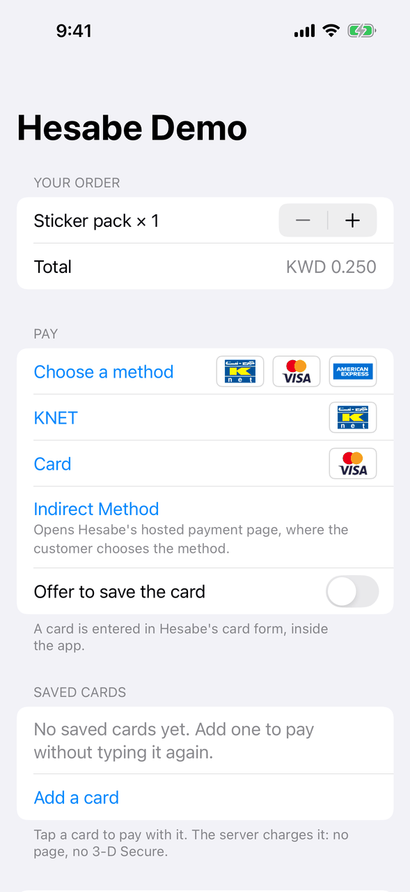
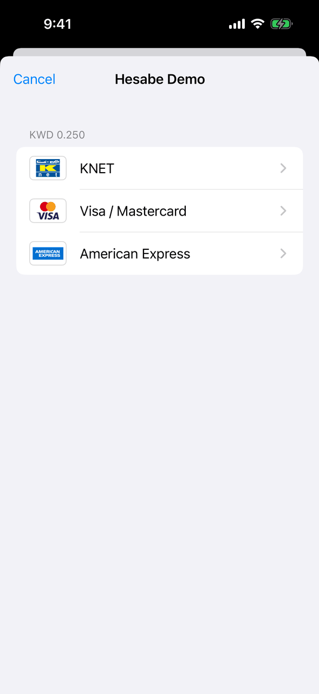
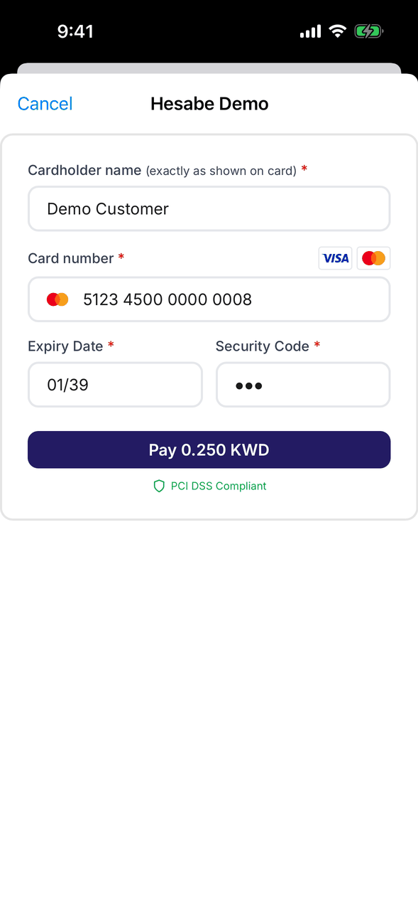
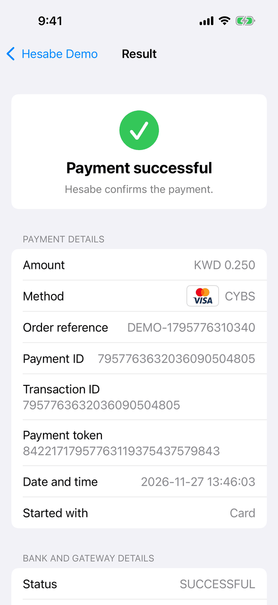
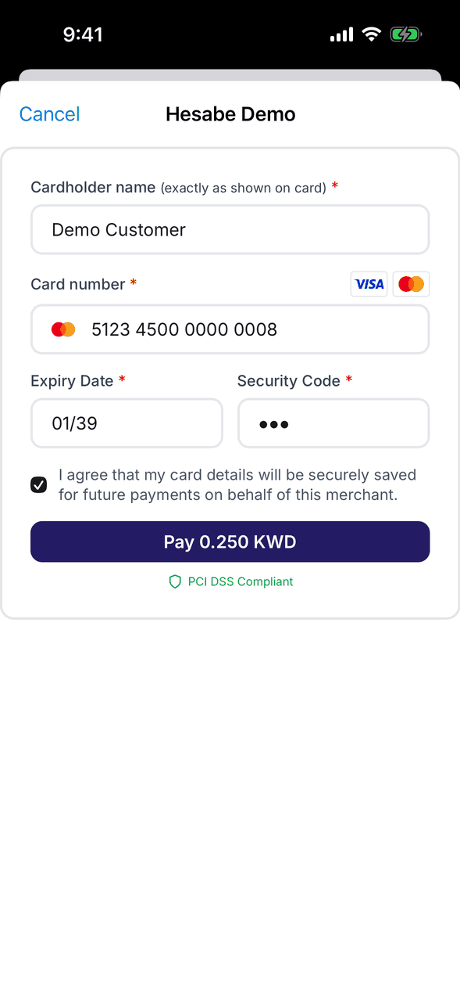
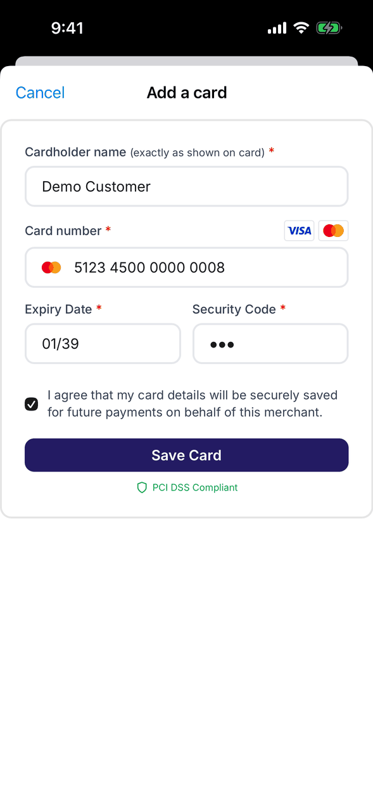
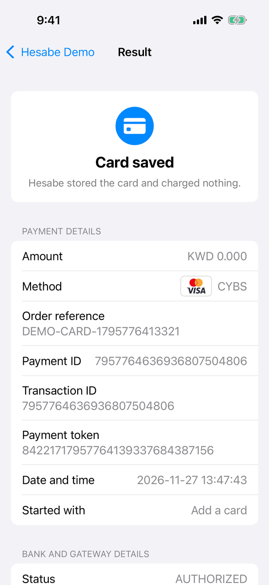
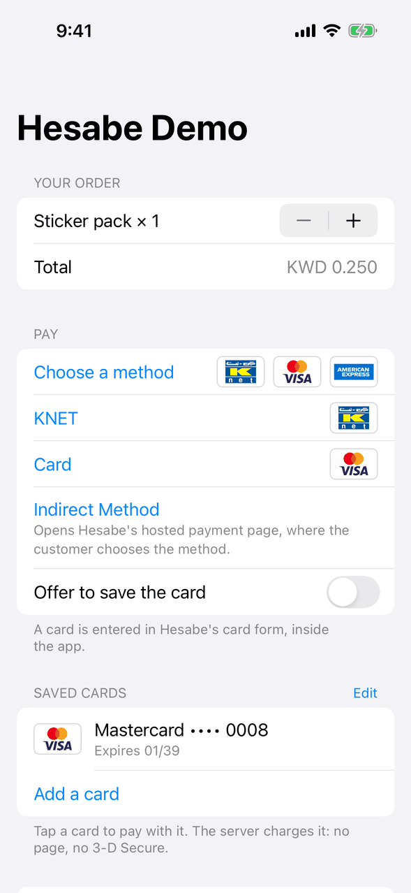
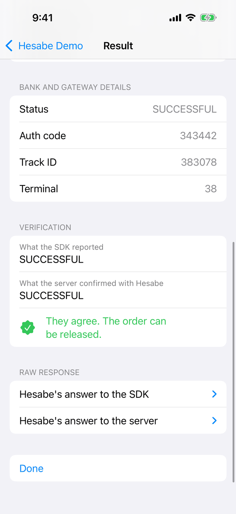
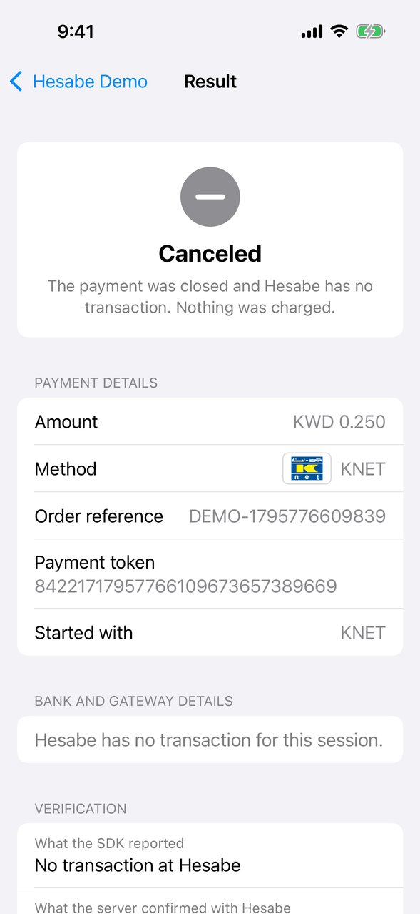

# Hesabe iOS SDK: integration guide

The Hesabe iOS SDK adds KNET, Visa and Mastercard, saved cards and Apple Pay to an iOS
app. Your server creates a payment session with your merchant keys. The app hands the
session to the SDK. The SDK shows the payment, follows the customer through KNET, 3-D
Secure or Apple Pay, asks Hesabe how the payment ended, and returns that to your app.

The app holds no merchant key and does no encryption. A card number is typed into
Hesabe's own card form and never passes through your app's code or your server.

This guide goes from an empty project to a paid order in six steps, then covers each use
case with its code. [How it works](HOW-IT-WORKS.md) explains what happens underneath.
The code comes from the complete app in [`demo/`](../demo).

| Pay | Choose a method | Card form | Result |
|---|---|---|---|
|  |  |  |  |

## Requirements

- Xcode 16 or later. The package manifest asks for the Swift 6.0 tools.
- iOS 15 or later.
- No other package and no pod. The SDK uses Foundation, UIKit, SwiftUI, WebKit and
  PassKit.
- No entitlement and no `Info.plist` entry.

The package has two products:

| Product | Use it when |
|---|---|
| `HesabeUI` | You want the checkout sheet and the Apple Pay button. It includes `Hesabe`. |
| `Hesabe` | You draw every screen yourself. It has sessions, lookups and results, and no UI. |

## What you need from Hesabe

1. A merchant account with its keys from Merchant Panel, Profile, Merchant Keys: merchant
   code, access code, secret key (32 characters), IV key (16 characters). They go on your
   server, never in the app.
2. For cards in the embedded form and for saved cards: the Direct Method enabled on your
   account. Email support@hesabe.com.
3. For the Apple Pay button: Apple Pay enabled on your account (email support@hesabe.com)
   and a domain of yours registered with Apple through Hesabe (email
   itsupport@hesabe.com). [Add the Apple Pay button](#add-the-apple-pay-button) has the
   details.

Hesabe's sandbox account, published in its documentation, is enough for every step
except Apple Pay.

## Step 1. Add the SDK

### With Swift Package Manager in Xcode

1. Choose File, Add Package Dependencies.
2. Enter `https://github.com/hesabe-tech-team/api2-kit-swift-ios` in the search field.
3. Set Dependency Rule to Up to Next Major Version, from `1.0.0`.
4. Choose Add Package, and add the `HesabeUI` product to your app target.

### In a `Package.swift`

```swift
dependencies: [
    .package(url: "https://github.com/hesabe-tech-team/api2-kit-swift-ios", from: "1.0.0"),
],
targets: [
    .target(
        name: "Checkout",
        dependencies: [.product(name: "HesabeUI", package: "api2-kit-swift-ios")]),
]
```

### In a project that uses CocoaPods

The SDK has no podspec. A CocoaPods project takes it as a Swift package, beside its pods:
CocoaPods manages the `Pods` project, and the package belongs to your app's own project.

1. Open the `.xcworkspace` that CocoaPods created, as you do every day.
2. In the Project navigator select your app's project, not `Pods`. In the editor select
   the project again, above the targets, and open the Package Dependencies tab.
3. Choose `+`, enter `https://github.com/hesabe-tech-team/api2-kit-swift-ios`, set
   Dependency Rule to Up to Next Major Version from `1.0.0`, and choose Add Package.
4. Add the `HesabeUI` product to your app target.
5. Build. Nothing changes in the `Podfile`.

`pod install` and `pod update` leave the package where it is. Xcode records the resolved
version in `Package.resolved` inside the workspace, at
`YourApp.xcworkspace/xcshareddata/swiftpm/Package.resolved`. Commit that file with the
workspace so every machine builds the same version.

Check: `import HesabeUI` compiles in a file of your app target.

## Step 2. Create the session on your server

A session is one payment. Your server creates it with the Checkout API, the same request
Hesabe's other integrations use: `POST https://sandbox.hesabe.com/checkout` on the
sandbox and `POST https://api.hesabe.com/checkout` in production, encrypted with your
keys, with your access code in the `accessCode` header. This is the payload before
encryption:

```json
{
  "merchantCode": "842217",
  "amount": "1.000",
  "currency": "KWD",
  "paymentType": 0,
  "orderReferenceNumber": "ORDER-1001",
  "responseUrl": "https://example.com/hesabe/return",
  "failureUrl": "https://example.com/hesabe/return",
  "version": "2.0"
}
```

| Field | What to send |
|---|---|
| `merchantCode` | Your merchant code. |
| `amount` | A string with exactly three decimals. Your server computes it. |
| `currency` | `KWD`. |
| `paymentType` | `0`. The app chooses the method, so one session serves every method. |
| `orderReferenceNumber` | Your own order number. Hesabe returns it with the payment. |
| `responseUrl`, `failureUrl` | The same two URLs for every payment. Nothing has to exist at them: the SDK stops the navigation before it loads. |
| `version` | `"2.0"`. A session that carries a customer for saved cards is `"3.0"`. |

Hesabe's answer is encrypted the same way. Decrypted, it has the session's `token` and
`response.data`:

```json
{
  "status": true,
  "code": 200,
  "token": "842217...",
  "response": { "data": "9e5a960d..." }
}
```

- `response.data` is what the app needs. It is a hex string of about 190 characters. It
  opens this one payment and cannot create another, so it is safe on the device.
- `token` is what your server looks the payment up by afterwards. Store it with the
  order.

The endpoint your app calls is yours to shape. The app says what was ordered, never what
it costs, and gets the session back. This is the one the demo is written against:

```http
POST /payments/session
{"quantity": 2}

200 OK
{"data": "9e5a960d...", "token": "842217...", "reference": "ORDER-1001", "amount": "0.500"}
```

Check: open `https://sandbox.hesabe.com/payment?data=` followed by the `data` string in a
browser. Hesabe's payment page appears.

## Step 3. Configure the SDK

```swift
import HesabeUI

let configuration = HesabeConfiguration(
    environment: .sandbox,
    returnURLs: ReturnURLs(URL(string: "https://example.com/hesabe/return")!),
    merchantDisplayName: "Example Store"
)
```

| Value | What it is |
|---|---|
| `environment` | `.sandbox` or `.production`. A session works only on the gateway that created it. |
| `returnURLs` | The `responseUrl` and `failureUrl` from Step 2. The SDK ends the payment when Hesabe navigates to either. `ReturnURLs(success:failure:)` takes two different ones. |
| `merchantDisplayName` | The title above the payment page. |
| `applePayPageURL` | The hosted Apple Pay button page. Needed by the Apple Pay button only. |

None of these is secret. Create the configuration once and reuse it.

## Step 4. Present the checkout

In UIKit, from the view controller on screen:

```swift
let session = try HesabeSession(data: dataFromYourServer)
let sheet = HesabeCheckoutSheet(configuration: configuration)

switch await sheet.present(session, methods: [.knet, .card], from: self) {
case .paid(let transaction):
    showReceipt(transaction.orderReference)
case .cardSaved:
    reloadSavedCards()
case .failed, .canceled, .notStarted:
    offerToPayAgain()
case .pending, .unconfirmed:
    showOrderIsBeingChecked()
}
```

In SwiftUI, the sheet appears when the session becomes non-nil:

```swift
.hesabeCheckout(session: $session, configuration: configuration, methods: [.knet, .card]) { result in
    handle(result)
}
```

The sheet is on screen as soon as it is called. It shows a loader while it reads the
session, while the payment page opens and while it asks Hesabe how the payment ended, so
a tap is always answered. The customer leaves through Cancel, and the sheet closes itself
when the payment has a result.

Check: on the sandbox, pay with KNET test card `8888880000000001`, expiry `09/30`, PIN
`1234`. The sheet shows "Payment complete" and returns `.paid`.

## Step 5. Handle the result

`present` returns one of seven results. Every one comes from asking Hesabe, never from
the redirect.

| Result | Meaning | What the app does |
|---|---|---|
| `.paid` | Hesabe confirms the payment. | Show the receipt. |
| `.cardSaved` | Hesabe stored the card and charged nothing. | Reload the saved cards. |
| `.failed` | Hesabe recorded the attempt and it did not go through. | Offer to pay again with a new session. |
| `.pending` | Hesabe has the payment and has not settled it. | Do not charge again. Check later. |
| `.canceled` | The customer closed the payment and Hesabe has no transaction. | Nothing was charged. |
| `.unconfirmed` | The flow ended and Hesabe could not be asked. | The customer may have been charged. Check from your server. |
| `.notStarted` | The session was refused or the page never loaded. | Nothing was charged. Create a new session. |

`.paid`, `.cardSaved`, `.failed` and `.pending` carry a `HesabeTransaction`, Hesabe's
record of the payment:

| Property | What it holds |
|---|---|
| `status` | Hesabe's status word: `SUCCESSFUL`, `FAILED`, or `AUTHORIZED` for a saved card. |
| `amount` | The amount with three decimals, as Hesabe writes it. |
| `orderReference` | The `orderReferenceNumber` your server sent. |
| `token` | The session token. |
| `paymentID`, `transactionID` | Hesabe's ids for the payment. |
| `trackID`, `terminal` | The gateway's track id and terminal. |
| `authCode` | The bank's authorisation code, when Hesabe reports one. |
| `paymentType` | Hesabe's name for the method used, for example `KNET`. |
| `cardType`, `maskedCard` | The card scheme and the masked number, when Hesabe reports them. |
| `datetime` | Kuwait time (UTC+3) with no zone, as Hesabe writes it. |
| `rawJSON` | The whole record as indented JSON. |

`rawJSON` includes the customer's name, email and mobile number as your server sent them
to Hesabe. Keep it out of logs and off the screens your customers see.

A session is single use. After any result except `.notStarted`, the next attempt needs a
new session from your server.

## Step 6. Confirm the payment on your server

The result in the app is for the screen. It travelled through the customer's device, so
it does not release an order. Your server asks Hesabe itself, with your keys:

1. When it creates the session, your server stores the `token` with the order.
2. When the app reports a result, or when Hesabe's webhook arrives, your server looks the
   payment up by that token with the Transaction Enquiry API:
   `GET https://api.hesabe.com/api/transaction/<token>`, with the `accessCode` header.
3. The order is paid when Hesabe's record says `SUCCESSFUL` and its amount and order
   reference are the order's.

A session nobody has paid has no transaction, and Hesabe answers "not found".

The demo's server answers the app like this, and the demo shows the two answers side by
side:

```http
POST /payments/confirm
{"token": "842217..."}

200 OK
{"paid": true, "status": "SUCCESSFUL", "transaction": {...}}
```

Check: after a sandbox payment, your server's lookup and the SDK's result agree.

## Use cases

### Let the customer choose a method

Pass several methods. The sheet shows a native list of those enabled on your account,
each with Hesabe's logo, then opens the chosen one.

```swift
await sheet.present(session, methods: [.knet, .card, .amex], from: self)
```

A method that is not enabled on the account is left out of the list. If only one of them
is enabled the sheet opens it directly, and if none is the sheet returns `.notStarted`.
Closing the list returns `.canceled`.

### Open one method directly

Pass one method. The sheet skips the list and opens that method: `[.knet]` goes straight
to KNET's page.

```swift
await sheet.present(session, methods: [.knet], from: self)
```

A payment method is Hesabe's payment type id. `.knet` is 1, `.card` is 2 and `.amex` is
7. Any other id works as `PaymentMethod(rawValue: 18)`. Google Pay, type 16, is not part
of the iOS SDK: the method list never offers it.

### Take a card in Hesabe's card form

Pass `[.card]`, or let the customer pick the card in the method list. The sheet shows
Hesabe's embedded card form under your app's own title bar: the card fields and a pay
button, with 3-D Secure in the same sheet.

```swift
await sheet.present(session, methods: [.card], from: self)
```

Hesabe has one card type per card gateway: 2 is Visa and Mastercard through MPGS, and 5
is the same cards through CyberSource. Which one an account has is Hesabe's setting, so
`.card` means Visa and Mastercard on either, and `.amex` stands for types 7 and 8 the
same way. Pass `.card` and build nothing on the gateway's id.

The form needs the Direct Method on your account. Without it, and for American Express
until the form lists it for your account, the sheet opens Hesabe's payment page for the
card instead.

### Use Hesabe's hosted payment page

Pass no methods. The sheet opens Hesabe's Indirect Method page, where the customer
chooses among every method enabled on your account.

```swift
await sheet.present(session, from: self)
```

### Add the Apple Pay button

Apple Pay through Hesabe starts from a web page on a domain registered with Apple, and
WebKit refuses to start it from a page inside the app. So the button is WebKit's own
Apple Pay button, drawn by a small hosted page in a web view the size of the button. You
host that page. It is the same file for every payment and holds no keys.

Set it up once:

1. Ask Hesabe to enable Apple Pay on your account (support@hesabe.com), and ask which
   Apple Pay payment types it has: `11` is KNET debit, `13` is KNET international, `9` is
   MPGS.
2. Email itsupport@hesabe.com with the domain that will serve the button page. Hesabe
   sends back a domain association file. Serve it as plain text at
   `https://your-domain.com/.well-known/apple-developer-merchantid-domain-association.txt`,
   and only then tell Hesabe to verify. A verification that runs before the file is live
   fails silently.
3. Copy [`hosting/apple-pay.html`](../hosting/apple-pay.html) to that domain. Any static
   host works. Use the exact host you registered: if you registered the apex, do not use
   `www`.
4. Give the page's address to the SDK, in the configuration from Step 3:

```swift
let configuration = HesabeConfiguration(
    environment: .production,
    returnURLs: ReturnURLs(URL(string: "https://example.com/hesabe/return")!),
    merchantDisplayName: "Example Store",
    applePayPageURL: URL(string: "https://example.com/apple-pay.html")
)
```

Then place the button in your own screen, with a session from Step 2:

```swift
HesabeApplePayButton(
    session: session,
    configuration: configuration,
    method: .applePayKNETDebit,
    type: .buy,
    style: .automatic,
    cornerRadius: 8
) { result in
    handle(result)
}
```

- `method` is the Apple Pay payment type on your account.
- `type` is the wording: `plain`, `buy`, `checkout`, `book`, `subscribe`, `donate` or
  `order`. `style` is `automatic`, `black`, `white` or `whiteOutline`.
- The button shows a stand-in while the page loads, "Processing" while Hesabe charges,
  and "Try again" with the reason when it cannot start.
- Closing the Apple Pay sheet is not a result. The button stays ready.
- A session is single use. Give the button a new session, and a new `.id`, for the next
  payment. This is the demo's button:

```swift
HesabeApplePayButton(
    session: applePayOrder.session, configuration: Config.hesabe, method: Config.applePayMethod
) { result in
    show(PaymentRecord(result, flow: .applePay, order: applePayOrder))
    applePayRound += 1
}
.id(applePayOrder.token)
```

Each Apple Pay payment type has its own registration with Apple. On a production account
in November 2026 the same domain was accepted for type `11` and refused for type `13`.
Ask Hesabe to register the domain for each type you use.

Apple Pay test cards do not work on Hesabe's sandbox at the time of writing (Hesabe,
November 2026), so test the button on production with a small amount.

### Offer to save the card during a payment

Saved cards belong to a Hesabe customer, and every call that touches them needs your
keys, so they are your server's. The app shows the card form and the list.

Your server creates the Hesabe customer once per user, with
`POST api/direct-payment/customer`, and keeps the `customer_id` it returns in the user's
row:

```json
{
  "merchantCode": "842217",
  "name": "Demo Customer",
  "email": "demo.customer@example.com",
  "mobile_number": "50000001"
}
```

Hesabe refuses a second customer with the same email or mobile number.

To offer saving, your server puts the customer on the session. These three fields join
the payload from Step 2:

```json
{
  "saveCard": true,
  "customer_id": 4026,
  "version": "3.0"
}
```

The app presents the session as before. The card form then shows "I agree that my card
details will be securely saved". A customer who agrees and pays gets `.paid`, and the
card is in your server's list afterwards.

### Save a card without a charge

Your server creates the same session with amount `"0.000"`. The form's button reads "Save
Card", nothing is charged, and the SDK returns `.cardSaved`. The session decides what the
sheet shows, so the app passes no methods:

```swift
let session = try HesabeSession(data: zeroAmountSessionFromYourServer)
if case .cardSaved = await sheet.present(session, from: self) {
    reloadSavedCards()
}
```

The form refuses a card the customer has already saved: "This card is already saved.
Please use your saved card to proceed."

| Saving while paying | Saving without a charge | The result | The card in the demo's list |
|---|---|---|---|
|  |  |  |  |

### List, charge and remove saved cards

| What happens | Who does it | Hesabe call |
|---|---|---|
| List the customer's cards | Your server | `GET api/direct-payment/cards` |
| Pay with a saved card | Your server | `POST api/direct-payment/charge-card` |
| Remove a card | Your server | `DELETE api/direct-payment/cards/{cardId}` |

`HesabeSavedCard` decodes each entry of Hesabe's `cards` list unchanged, so your server
can pass the list through:

```swift
struct CardList: Decodable { let cards: [HesabeSavedCard] }

let cards = try JSONDecoder().decode(CardList.self, from: dataFromYourServer).cards
Text(cards[0].displayName)  // Mastercard •••• 0008
```

To pay with a saved card, the app sends the card's `id` to your server, and your server
charges it. This is the demo's charge, in the place of your server:

```swift
// With the customer on the charge, Hesabe refuses a card saved by anyone else.
// Sent once and never again: Hesabe has no idempotency keys, so a retry is a
// second charge.
let answer = try await send("POST", "api/direct-payment/charge-card", [
    "card_id": card.id,
    "amount": amount,
    "customer_id": customer,
    "order_reference": reference,
])
```

A charge has no page and no 3-D Secure: Hesabe authenticated the card when it was saved.
The answer to your server is the result, `CAPTURED` when paid, so there is nothing for
the SDK to confirm. Ask the customer before charging: the demo asks "Pay KWD 0.250 with
Mastercard •••• 0008?".

Before removing a card, your server checks that it belongs to the signed-in customer:
Hesabe's call takes any card id of the merchant. The saved-card calls allow 30 a minute.

### Show a result screen

The SDK's own confirmation is one line in the sheet: "Payment complete", "Card saved" or
"Payment not completed". The screen after it is yours. The demo's result screen shows
what a customer and a support agent need, and where each row comes from:

| Row | Source |
|---|---|
| Amount | `transaction.amount` |
| Method, with Hesabe's logo | `transaction.paymentType`, `HesabeMethodLogo` |
| Card | `transaction.maskedCard` |
| Order reference | `transaction.orderReference` |
| Payment ID, Transaction ID | `transaction.paymentID`, `transaction.transactionID` |
| Payment token | The `token` your server returned with the session |
| Date and time | `transaction.datetime` |
| Status | `transaction.status` |
| Auth code | `transaction.authCode` |
| Track ID, Terminal | `transaction.trackID`, `transaction.terminal` |
| What the SDK reported | The `PaymentResult` |
| What the server confirmed | Your server's own lookup, from Step 6 |
| Raw response | `transaction.rawJSON`, for a developer build |

| Paid | Bank details and verification | Canceled |
|---|---|---|
|  |  |  |

Show amounts as Hesabe reports them. Do not compute them on the device.

### Let the customer pay again after a failed payment

`.failed` means Hesabe recorded the attempt and nothing was charged. The session is
spent, so "Try again" asks your server for a new one and presents it. This is how the
demo starts every payment, and how it starts one again:

```swift
private func start(_ flow: PaymentRecord.Flow) {
    busy = .paying(flow)
    Task {
        do {
            // "Add a card" is a session with amount 0.000: the sheet shows the card
            // form and saves the card.
            let order = try await (flow == .addCard
                ? server.createCardSession()
                : server.createSession(quantity: quantity, saveCard: offersCardSaving))
            attempt = Attempt(order: order, flow: flow)
            sheetSession = order.session
        } catch {
            busy = nil
            failure = Failure(title: "Could not start the payment", message: error.localizedDescription) {
                start(flow)
            }
        }
    }
}
```

`server` stands in for your server in the demo. The spinner stays on the button from the
tap until the payment has a result, so a payment cannot be started twice.

### Check a payment that is pending or unconfirmed

`.pending` and `.unconfirmed` mean the customer may have been charged. Do not offer to
pay again. Offer "Check status again", which asks Hesabe by the session token:

```swift
let result = await HesabeClient(environment: Config.environment)
    .settle(token: token, afterReturn: false)
```

Then have your server confirm it, as in Step 6. Your server is also where a payment that
stays unconfirmed is settled, from the webhook or a later lookup.

### Settle payments the app never saw finish

A customer can pay in a banking app and never come back, and iOS can close the app during
3-D Secure. The SDK writes each session token down before the payment page opens. Call
this once at launch:

```swift
let settled = await HesabeClient(environment: .sandbox).recoverPayments()
```

It returns the payments that have since been paid, saved or failed, each once. Show them
as results and have your server confirm them.

### Show Arabic, or your own wording

The few words the SDK shows itself are in `HesabeStrings`. `.automatic`, the default, is
Arabic when the device's first language is Arabic and English otherwise, and Hesabe's
card form is asked for the same language. To change a text, start from a language and
replace it:

```swift
var strings = HesabeStrings.english
strings.paid = "Thank you. Your order is on its way."

let sheet = HesabeCheckoutSheet(configuration: configuration, strings: strings)
```

`.hesabeCheckout` and `HesabeApplePayButton` take the same `strings` argument.

### Show Hesabe's logos in your own screens

The method list draws Hesabe's own logo for each method on a white badge, so it reads the
same in light and dark mode. Your own buttons and rows can use the same badge:

```swift
HesabeMethodLogo(.knet)                               // SwiftUI
let image = await HesabeLogos.badge(for: .knet)       // UIKit, a UIImage or nil
```

The logos are fetched once from Hesabe's assets bucket,
`hesabe-assets-ir.s3.eu-west-1.amazonaws.com`, by payment type id. A method Hesabe has no
logo for shows its name alone. Where an app or a network allows only named hosts, allow
that host too.

### Draw every screen yourself

The `Hesabe` product has no UI. It reads a session, builds the page addresses and asks
Hesabe for the outcome:

```swift
import Hesabe

let client = HesabeClient(environment: .sandbox)
let details = try await client.details(for: session)     // token, amount, enabled methods
let methods = details.offered(from: [.knet, .card])
let page = client.paymentURL(for: session, method: .knet)

// Load `page` in your own web view. When it navigates to one of your return URLs:
let result = await client.settle(token: details.token, afterReturn: true)
```

The checkout sheet does a number of things around that web view which your own screen
then has to do: [How it works](HOW-IT-WORKS.md#what-the-web-view-has-to-do) lists them.
Keep `details.token` until the payment is settled. `recoverPayments()` covers only the
payments the SDK's own sheet and button started.

## Test on the sandbox

| Method | Test card | Expiry | Code | Result |
|---|---|---|---|---|
| KNET | `8888880000000001` | `09/30` | PIN `1234` | Paid |
| Visa or Mastercard | `5123450000000008` | `01/39` | `100` | Paid |

- KNET's sandbox page asks for the card, then shows a Confirm step.
- A sandbox session is paid on `sandbox.hesabe.com` only, and a production session on
  `api.hesabe.com` only.
- Apple Pay is tested on production. See
  [Add the Apple Pay button](#add-the-apple-pay-button).

## Go live

1. Your server creates sessions on `https://api.hesabe.com` with your production keys.
2. The app's configuration says `environment: .production`.
3. `returnURLs` in the app match the `responseUrl` and `failureUrl` your server sends.
4. Your server confirms every payment before it releases the order.
5. No merchant key is in the app. The demo's `SandboxMerchantServer.swift` is not in it
   either.
6. For Apple Pay: the button page is live on the registered domain, and
   `applePayPageURL` points at it.
7. The SDK keeps the tokens of payments in flight in `UserDefaults`. If your app has a
   privacy manifest, list `NSPrivacyAccessedAPICategoryUserDefaults` in it with reason
   `CA92.1`.

## Run the demo

The demo is this guide as a complete app: one product, a quantity, the checkout sheet
four ways, saved cards, a result screen for every payment, a payment history, and the
Apple Pay button. Open `demo/HesabeDemo.xcodeproj` in Xcode 16 and run it on a simulator.
There is nothing else to install or start.

A demo that runs by itself has no server to keep the keys on. One file,
[`SandboxMerchantServer.swift`](../demo/HesabeDemo/SandboxMerchantServer.swift), does a
server's work inside the app with Hesabe's published sandbox keys. It is fixed to the
sandbox and is not part of the SDK. Do not ship it and do not copy it into an app:
anything compiled into an app can be read out of it. Each of its methods is one endpoint
of the server you build:

| The app calls | It sends | Your server answers |
|---|---|---|
| `POST /payments/session` | `{"quantity": 2, "saveCard": false}` | `{"data": "9e5a960d...", "token": "842217...", "reference": "ORDER-1001", "amount": "0.500"}` |
| `POST /payments/confirm` | `{"token": "842217..."}` | `{"paid": true, "status": "SUCCESSFUL", "transaction": {...}}` |
| `POST /cards/session` | `{}` | The same answer as `/payments/session`, with amount `"0.000"`. |
| `GET /cards` | | `{"cards": [...]}`, Hesabe's list unchanged. |
| `POST /cards/charge` | `{"cardId": 2001, "quantity": 2}` | `{"paid": true, "status": "CAPTURED", "amount": "0.500", "reference": "ORDER-1002"}` |
| `POST /cards/remove` | `{"cardId": 2001}` | `{"removed": true}` |

The paths are yours to name. Your server takes the customer from its own login, never
from a value the app sends.

## If something goes wrong

- `.notStarted(.rejected("Failed to decrypt data parameter"))`: the string is not
  `response.data`, the session was already used, or it was created on the other
  environment.
- `.notStarted(.configuration("none of the requested payment methods is enabled..."))`:
  the methods you passed are not enabled on the account. Ask Hesabe to enable them.
- The sheet stays on your own return page: `returnURLs` does not match the `responseUrl`
  your server sent.
- `.notStarted(.rejected("the payment page answered HTTP 403"))`: Hesabe refused to serve
  the card form. It is served to in-app web views only.
- The card form has no "save" checkbox: the session has no `customer_id`, or `saveCard`
  is not `true`.
- The card form says "This card is already saved": charge the saved card from your server.
- Your server gets "Too Many Attempts": the saved-card calls allow 30 a minute.
- `.unconfirmed(.noTransaction)` after the customer returned: Hesabe had not recorded the
  payment within ten seconds. Look it up from your server.
- The Apple Pay button shows "Try again": the message beside it says why. The usual
  causes are a missing `applePayPageURL` and an Apple Pay type that is not enabled.
- The Apple Pay sheet shows "Payment Not Completed" without asking to confirm: the domain
  is not registered for that payment type, or it was verified before the association file
  was live.
- KNET opens and nothing happens after the bank app: the bank app did not return. The
  payment is settled at the next launch by `recoverPayments()`.
- The method list shows names without logos: the app or the network blocks
  `hesabe-assets-ir.s3.eu-west-1.amazonaws.com`.
